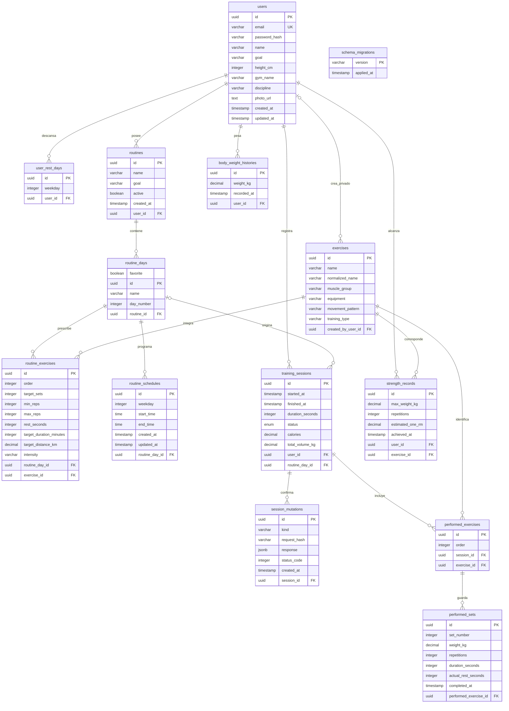

# Base de datos Gymbro — esquema normalizado (20/10/2026)

Estado histórico: aplicado a PostgreSQL local. Para el esquema actual, consultar DIAGRAMA-BASE-DE-DATOS.md y las migraciones de backend/sql/supabase/.

Hay 12 tablas de negocio y dos tablas técnicas: schema_migrations y session_mutations. El diagrama muestra las 14 tablas.

## Cambios aplicados

- Se cargaron 107 ejercicios y se conservaron los existentes: total oficial 114. La carga inicial puede repetirse sin duplicar.
- Se incorporó el registro de peso con fecha/hora. Las mediciones viven en body_weight_histories. La interfaz consulta las últimas 30, sin eliminar las anteriores.
- users.current_kg fue retirado: la API calcula currentKg desde la medición más reciente. Cambiar el peso en Perfil agrega una medición solo si cambió. Insertar una medición antigua no cambia el peso actual.
- users.rest_days fue migrado a user_rest_days, con una fila por día y usuario. La API mantiene restDays como arreglo para compatibilidad con Android y Angular.
- routine_days.schedule fue retirado después de transferir sus horarios a routine_schedules. La API sigue devolviendo schedule calculado desde esa tabla.
- exercises tiene created_by_user_id: NULL significa oficial, un UUID significa privado de ese usuario. No se agrega visibility porque repetiría esa misma información.
- normalized_name es una clave técnica derivada del nombre. Un trigger SQL la mantiene sincronizada. No distingue tildes, mayúsculas ni espacios repetidos; no interpreta sinónimos, abreviaturas o variantes técnicas.
- Índice único parcial para nombres oficiales e índice único por propietario para privados. Un trigger también impide crear un privado con nombre oficial. La creación usa bloqueo transaccional por nombre para resistir solicitudes simultáneas.
- La API lista oficiales y propios; valida también los IDs al crear rutinas y registrar ejercicios en sesiones. El ranking público solo considera ejercicios oficiales.
- Restricciones SQL para días 0 a 6, horarios con inicio anterior al fin, tipos válidos, pesos positivos y objetivos/series válidos.
- schema_migrations registra la versión 20261020_normalize y su fecha. La migración es transaccional y repetible; no se utiliza sync alter ni force.

## Datos calculados que se conservan

training_sessions.total_volume_kg y calories son resultados almacenados al finalizar una sesión. strength_records conserva registros históricos de marcas y estimaciones. No son nuevas fuentes para el peso corporal ni para el catálogo; el ranking se calcula desde series completadas. Se mantienen como resultados históricos del entrenamiento, no se promete una normalización estricta de todos los atributos calculados.

El nombre del gimnasio y la disciplina siguen siendo texto libre del perfil. No se crean entidades de Gymbro Manager antes de implementar su lógica de pertenencia y permisos.

## Backup y verificación

Backup previo completo: backups/gymbro-before-normalization-2026-10-20.dump (ignorado por Git). Formato pg_dump custom, verificado con pg_restore.

Se ensayó sobre una copia restaurada y sobre una instalación vacía. La auditoría comparó huellas de todos los registros originales y comprobó el significado de pesos actuales y descansos después de migrar.

Comandos:

- npm run db:migrate: aplica versiones pendientes en la base configurada.
- npm run db:seed:exercises --workspace backend: agrega el catálogo oficial que falta; no genera usuarios ni rutinas.
- npm run db:verify:normalization --workspace backend: integración contra la copia llamada gymbro_normalization_test, nunca contra la base principal. Requiere crear esa copia y migrarla previamente.

No restaures el backup sobre la base principal para ejecutar pruebas: usá una base independiente. El rollback completo requiere restaurar el backup en una instancia aparte y coordinar cualquier dato creado después de la migración.

## Recuperación y sincronización

La versión 20261020_offline_sessions agrega session_mutations. Sus recibos contienen operación UUID, sesión, tipo, huella de solicitud, respuesta y estado HTTP. Se guardan en la misma transacción que la operación. No se eliminan automáticamente para conservar la seguridad de reintentos antiguos.

Todas las escrituras de series y el cierre bloquean la fila de la sesión. Una sesión COMPLETED devuelve su cierre original sin recalcularlo. CANCELLED no se puede finalizar. Un PUT repetido con el mismo operationId recupera la respuesta previa y no vuelve a editar los datos.

El dispositivo mantiene un respaldo del entrenamiento y una cola por usuario/servidor. Guardar localmente no significa que el servidor ya recibió los datos: la interfaz muestra los pendientes. Ver [ENTRENAMIENTO-OFFLINE.md](ENTRENAMIENTO-OFFLINE.md).

Backup anterior a esta migración: backups/gymbro-before-offline-sessions-2026-10-20.dump.

## Diccionario de tablas

## session_mutations

| Campo | Tipo | Permite NULL | Clave |
|---|---|---|---|
| id | UUID | No | PK |
| kind | VARCHAR(20) | No |  |
| request_hash | VARCHAR(64) | No |  |
| response | JSONB | No |  |
| status_code | INTEGER | No |  |
| created_at | TIMESTAMP WITH TIME ZONE | No |  |
| session_id | UUID | No | FK |

## users

| Campo | Tipo | Permite NULL | Clave |
|---|---|---|---|
| id | UUID | No | PK |
| email | VARCHAR(255) | No | UK |
| password_hash | VARCHAR(255) | No |  |
| name | VARCHAR(255) | No |  |
| goal | VARCHAR(255) | Sí |  |
| height_cm | INTEGER | Sí |  |
| gym_name | VARCHAR(255) | Sí |  |
| discipline | VARCHAR(255) | Sí |  |
| photo_url | TEXT | Sí |  |
| created_at | TIMESTAMP WITH TIME ZONE | No |  |
| updated_at | TIMESTAMP WITH TIME ZONE | No |  |

## user_rest_days

| Campo | Tipo | Permite NULL | Clave |
|---|---|---|---|
| id | UUID | No | PK |
| weekday | INTEGER | No |  |
| user_id | UUID | No | FK |

## exercises

| Campo | Tipo | Permite NULL | Clave |
|---|---|---|---|
| id | UUID | No | PK |
| name | VARCHAR(255) | No |  |
| normalized_name | VARCHAR(255) | No |  |
| muscle_group | VARCHAR(255) | No |  |
| equipment | VARCHAR(255) | No |  |
| movement_pattern | VARCHAR(255) | Sí |  |
| training_type | VARCHAR(255) | No |  |
| created_by_user_id | UUID | Sí | FK |

## routines

| Campo | Tipo | Permite NULL | Clave |
|---|---|---|---|
| id | UUID | No | PK |
| name | VARCHAR(255) | No |  |
| goal | VARCHAR(255) | No |  |
| active | BOOLEAN | Sí |  |
| created_at | TIMESTAMP WITH TIME ZONE | No |  |
| user_id | UUID | No | FK |

## routine_days

| Campo | Tipo | Permite NULL | Clave |
|---|---|---|---|
| favorite | BOOLEAN | No |  |
| id | UUID | No | PK |
| name | VARCHAR(255) | No |  |
| day_number | INTEGER | No |  |
| routine_id | UUID | No | FK |

## routine_exercises

| Campo | Tipo | Permite NULL | Clave |
|---|---|---|---|
| id | UUID | No | PK |
| order | INTEGER | No |  |
| target_sets | INTEGER | No |  |
| min_reps | INTEGER | No |  |
| max_reps | INTEGER | No |  |
| rest_seconds | INTEGER | Sí |  |
| target_duration_minutes | INTEGER | Sí |  |
| target_distance_km | DECIMAL(7,2) | Sí |  |
| intensity | VARCHAR(255) | Sí |  |
| routine_day_id | UUID | No | FK |
| exercise_id | UUID | No | FK |

## routine_schedules

| Campo | Tipo | Permite NULL | Clave |
|---|---|---|---|
| id | UUID | No | PK |
| weekday | INTEGER | No |  |
| start_time | TIME | No |  |
| end_time | TIME | No |  |
| created_at | TIMESTAMP WITH TIME ZONE | No |  |
| updated_at | TIMESTAMP WITH TIME ZONE | No |  |
| routine_day_id | UUID | No | FK |

## training_sessions

| Campo | Tipo | Permite NULL | Clave |
|---|---|---|---|
| id | UUID | No | PK |
| started_at | TIMESTAMP WITH TIME ZONE | Sí |  |
| finished_at | TIMESTAMP WITH TIME ZONE | Sí |  |
| duration_seconds | INTEGER | Sí |  |
| status | ENUM | Sí |  |
| calories | DECIMAL(7,2) | Sí |  |
| total_volume_kg | DECIMAL(12,2) | Sí |  |
| user_id | UUID | No | FK |
| routine_day_id | UUID | Sí | FK |

## performed_exercises

| Campo | Tipo | Permite NULL | Clave |
|---|---|---|---|
| id | UUID | No | PK |
| order | INTEGER | No |  |
| session_id | UUID | No | FK |
| exercise_id | UUID | No | FK |

## performed_sets

| Campo | Tipo | Permite NULL | Clave |
|---|---|---|---|
| id | UUID | No | PK |
| set_number | INTEGER | No |  |
| weight_kg | DECIMAL(7,2) | No |  |
| repetitions | INTEGER | No |  |
| duration_seconds | INTEGER | Sí |  |
| actual_rest_seconds | INTEGER | Sí |  |
| completed_at | TIMESTAMP WITH TIME ZONE | Sí |  |
| performed_exercise_id | UUID | No | FK |

## body_weight_histories

| Campo | Tipo | Permite NULL | Clave |
|---|---|---|---|
| id | UUID | No | PK |
| weight_kg | DECIMAL(5,2) | No |  |
| recorded_at | TIMESTAMP WITH TIME ZONE | Sí |  |
| user_id | UUID | No | FK |

## strength_records

| Campo | Tipo | Permite NULL | Clave |
|---|---|---|---|
| id | UUID | No | PK |
| max_weight_kg | DECIMAL(7,2) | No |  |
| repetitions | INTEGER | No |  |
| estimated_one_rm | DECIMAL(7,2) | No |  |
| achieved_at | TIMESTAMP WITH TIME ZONE | Sí |  |
| user_id | UUID | No | FK |
| exercise_id | UUID | No | FK |

## Tabla técnica de versiones

| Campo de schema_migrations | Tipo |
|---|---|
| version (PK) | varchar(80) |
| applied_at | timestamp with time zone |

## Diagrama

